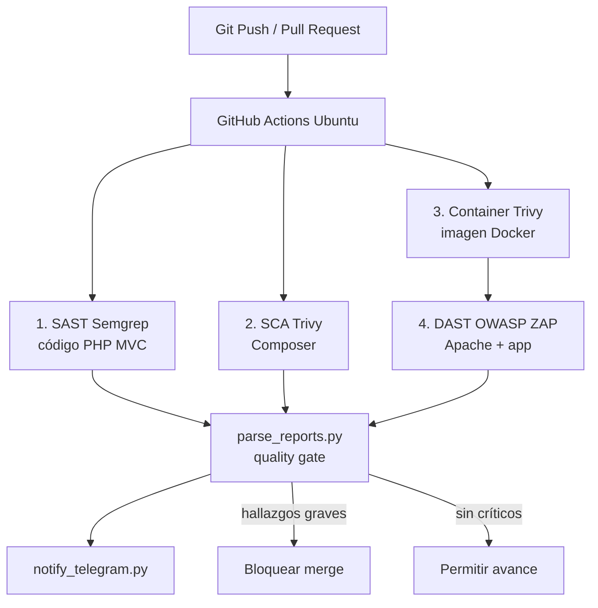

# DevSecOps Shield Pipeline

Sistema automatizado de seguridad de software (DevSecOps) pensado para funcionar como un **guardián de ciberseguridad** en un repositorio de GitHub.

La idea central es simular lo que hacen las empresas de tecnología avanzadas: **proteger el ciclo de vida del software en tiempo real** y evitar que código con vulnerabilidades graves o secretos expuestos llegue a un entorno de producción.

Este repositorio es un laboratorio de portafolio: una aplicación web PHP (MVC) con hallazgos controlados, más un pipeline que los detecta, los consolida y alerta.

## Flujo del pipeline

```text
[ Desarrollador hace Git Push / Pull Request ]
                             │
                             ▼
 ┌─────────────────────────────────────────────────────────┐
 │          Pipeline en GitHub Actions (Ubuntu)            │
 ├─────────────────────────────────────────────────────────┤
 │  1. SAST (Semgrep) ────► Analiza el código PHP (MVC)    │
 │  2. SCA (Trivy) ───────► Escanea dependencias Composer  │
 │  3. Container (Trivy) ─► Analiza la imagen Docker       │
 │  4. DAST (OWASP ZAP) ──► Levanta Apache y ataca la app  │
 └───────────────────────────┬─────────────────────────────┘
                             │
                             ▼
 ┌─────────────────────────────────────────────────────────┐
 │    Scripts en Python (automatización y calidad)         │
 ├─────────────────────────────────────────────────────────┤
 │  - parse_reports.py: evalúa los JSON y activa el gate   │
 │  - notify_telegram.py: envía alertas en vivo a Telegram │
 └───────────────────────────┬─────────────────────────────┘
                             │
              ┌──────────────┴──────────────┐
              ▼                             ▼
     Gate en rojo                    Gate en verde
     (bloqueo del merge)             (código puede seguir)
```



SAST y SCA pueden correr en paralelo. El DAST va después: necesita la imagen y Apache levantados. El escaneo nocturno (`nightly-scan.yml`) reutiliza las mismas capas sin un push.

## Qué protege el pipeline

| Capa | Herramienta | Qué busca |
| --- | --- | --- |
| SAST | Semgrep | Fallos en PHP MVC (inyecciones, XSS, secretos en código) |
| SCA | Trivy | CVE en `composer.lock` / paquetes de Composer |
| Contenedor | Trivy | CVE y secretos en la imagen Docker |
| DAST | OWASP ZAP | Ataques a la app servida por Apache |
| Quality gate | `parse_reports.py` | Une JSON y falla el job si hay hallazgos graves |
| Alertas | Telegram | Notifica hallazgos relevantes al equipo |

La app de laboratorio (`app/`) incluye **vulnerabilidades controladas** para demostrar que el pipeline las detecta.

## Estructura del repositorio

```
DevSecops-Shield-Pipeline/
├── .github/
│   └── workflows/
│       ├── security-pipeline.yml   # CI/CD principal (SAST, SCA, Container, DAST)
│       └── nightly-scan.yml        # Escaneos programados diarios
├── app/                            # Aplicación web MVC (PHP + Apache)
│   ├── src/
│   │   ├── controllers/
│   │   ├── models/                 # Acceso a datos (vulnerabilidad controlada)
│   │   └── views/
│   ├── public/
│   │   └── index.php               # Front controller
│   ├── composer.json               # Dependencias Composer
│   └── Dockerfile                  # Imagen PHP + Apache
├── config/
│   ├── semgrep-rules.yml
│   ├── trivy-ignore.yaml
│   └── zap-baseline.conf
├── docs/
│   ├── architecture.md
│   ├── threat-model.md
│   └── security-matrix.md
├── scripts/
│   ├── parse_reports.py
│   ├── notify_telegram.py
│   └── attack-simulation.sh
├── reports/
├── docker-compose.yml
├── LICENSE
└── README.md
```

## Uso local

Cuando el código de la app y los scripts estén en el repo:

```bash
docker compose up --build
```

La simulación local para validar el pipeline estará en `scripts/attack-simulation.sh`.

## Licencia

MIT. Ver [LICENSE](LICENSE).
